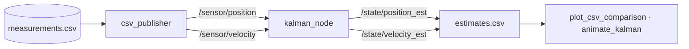

<div align="center">

# 📈 ROS 2 Kalman Filter

**A linear Kalman filter node for position / velocity state estimation in ROS 2, with replayable sensor data and visual evaluation.**


</div>

---

## ✨ Overview

Noisy position and velocity measurements are published as ROS 2 topics; the filter node fuses them with a **constant-velocity motion model** and publishes the estimated state. Results are logged to CSV and compared against the raw measurements with plots and an animation.



## 🧮 Model

State **x = [position, velocity]ᵀ**, sampling period **Δt = 0.1 s**

| Matrix | Value | Meaning |
|---|---|---|
| **A** | `[[1, 0.1], [0, 1]]` | constant-velocity transition |
| **H** | `I₂` | both states measured directly |
| **Q** | `diag(1e-4, 1e-4)` | process noise |
| **R** | `diag(1e-2, 1e-2)` | measurement noise |
| **P₀** | `diag(1, 1)` | initial covariance |

All parameters live in [`filter_params.py`](my_kalman_pkg/my_kalman_pkg/filter_params.py) for easy tuning.

## 📊 Results

| Correct tuning | Mis-tuned filter |
|---|---|
|  |  |

A recorded **rosbag2** of a full run is included for reproducible playback.

## 🚀 Getting Started

```bash
cd ~/ros2_ws/src && git clone https://github.com/Bariscompeng/ros2-kalman-filter.git
cd ~/ros2_ws && colcon build --packages-select my_kalman_pkg
source install/setup.bash

ros2 run my_kalman_pkg kalman_node     # terminal 1
ros2 run my_kalman_pkg csv_publisher   # terminal 2
```

## 📁 Structure

```
my_kalman_pkg/
├── my_kalman_pkg/
│   ├── kalman_node.py          # predict / update loop
│   ├── filter_params.py        # A, H, Q, R, P0
│   ├── csv_publisher.py        # replays measurements as topics
│   ├── plot_csv_comparison.py  # measurement vs estimate plots
│   └── animate_kalman.py       # GIF animation
├── data/measurements.csv
└── rosbag2_…/                  # recorded run
```

---

<div align="center">
Built by <a href="https://github.com/Bariscompeng">Barış Coşkun</a>
</div>
